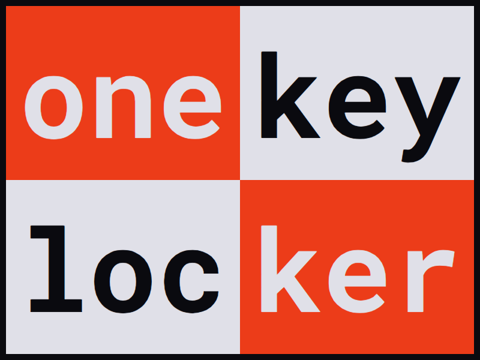

<p align="center"></p>

# OneKey Locker

> A one-day side project, January 2026, archived. The tested crypto package is the finished part; the API, the web client and hosting were never built. Original state: tag [`original-2026`](https://github.com/urtuba/onekey-locker/tree/original-2026).

## The idea

A digital locker for things you rarely read but must not lose: recovery codes, a note for family, a list of accounts. You write it once in the browser and get one key, as a link or a QR code. The browser encrypts the content before it leaves, so the server only ever stores ciphertext. Anyone with the key can read the locker, and the owner can update it.

## What exists

| Part | State |
|---|---|
| [`packages/crypto`](packages/crypto) | **Done.** Key generation, encryption with XSalsa20-Poly1305 (`nacl.secretbox`), blob IDs, base64url. 40 tests, run in CI. |
| `packages/api` | **Skeleton.** An Express server with health routes only. The blob endpoints it lists (`POST`, `GET`, `PUT /api/blob`) were never written. |
| `packages/api/prisma/schema.prisma` | **Design only.** A database schema far ahead of the code (TOTP, email checks, IP lists, rate limits, plans, an audit log); nothing uses it. |
| Web client, QR delivery, hosting | Not started. |

## How the keys work

- `privateKey`: 32 random bytes, the owner's secret.
- `publicKey`: SHA-512(privateKey), first 32 bytes. Despite the name it is a **secret read key**: the content is encrypted with it, symmetrically.
- Blob ID: SHA-512(read key), first 16 bytes. It names the locker in a URL without revealing the key.

## Design review

Looking back at the design in October 2026, one flaw stands out.

**The planned write path breaks zero-knowledge.** The API was meant to receive the private key (the `X-Priv-Key` header) to authorize updates. The read key is a hash of the private key, so a server that sees the private key can derive the read key and decrypt the locker.

**The fix:** derive independent keys from the owner's secret with a domain-separated hash, for example `readKey = H("read" ‖ secret)` and `writeToken = H("write" ‖ secret)`. The server stores only a hash of the write token and checks updates against it. Knowing the write token does not lead to the read key. Better still, sign updates with an Ed25519 key derived the same way, so the server never holds a reusable write secret either.

Other known weaknesses are in [SECURITY.md](SECURITY.md).

## Running the tests

You need Node 22.

```
npm ci
npm run test:crypto
```

`npm audit` lists advisories in the unfinished API's Prisma dependency and in the test tooling. The crypto package itself has none (`npm audit -w @onekey-locker/crypto --omit=dev`).

## License

[AGPL-3.0](LICENSE).
